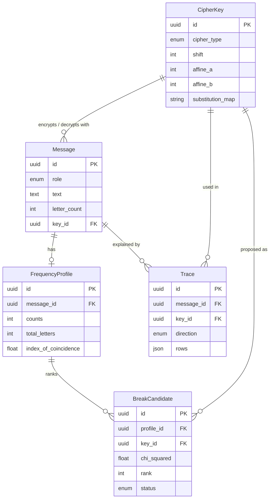
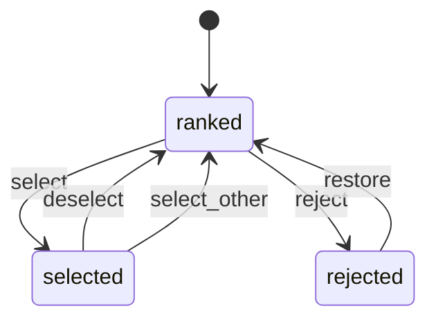

# 03 Domain & Schema

Stack-neutral. Notation: `Null` = nullable. IDs are UUIDs supplied by the caller (pure functions never generate IDs or read the clock). All math is exact integer arithmetic; letters map A=0 ... Z=25. The only floats are statistics (frequencies, chi-squared), never money.

Whether these entities are stored in a database or live only in browser memory is a Step 4 decision. The model is the same either way; "storage" below means "wherever the app keeps its state".

## Entities

### CipherKey
Owner: FEAT-001, FEAT-002.
| Field | Type | Null | Notes |
|---|---|---|---|
| id | uuid | no | PK |
| cipher_type | enum(caesar, affine, substitution) | no | |
| shift | int | yes | Caesar only; 0..25 |
| affine_a | int | yes | Affine only; must be a unit mod 26 (gcd(a,26)=1) |
| affine_b | int | yes | Affine only; 0..25 |
| substitution_map | string(26) | yes | Substitution only; a permutation of A..Z, position i holds the image of letter i |
| created_at | timestamp | no | |

Invariant: exactly the fields for `cipher_type` are set, the rest are null.

### Message
Owner: FEAT-001, FEAT-002, FEAT-003.
| Field | Type | Null | Notes |
|---|---|---|---|
| id | uuid | no | PK |
| role | enum(plaintext, ciphertext) | no | |
| text | text | no | Original characters; case and non-letters preserved |
| letter_count | int | no | Number of A-Z letters |
| key_id | uuid | yes | FK CipherKey, set null on delete |
| created_at | timestamp | no | |

Indexes: (key_id, created_at). Query served: list messages produced with a given key, newest first (session history panel).

### FrequencyProfile
Owner: FEAT-003, FEAT-004.
| Field | Type | Null | Notes |
|---|---|---|---|
| id | uuid | no | PK |
| message_id | uuid | no | FK Message, cascade, one-to-one |
| counts | int[26] | no | Letter counts, case-insensitive |
| total_letters | int | no | Sum of counts |
| relative_freq | float[26] | no | counts / total_letters; all zeros when total is 0 |
| index_of_coincidence | float | yes | null when total_letters < 2 |
| created_at | timestamp | no | |

Indexes: (message_id). Query served: fetch the frequency profile of a message.

### BreakCandidate
Owner: FEAT-004.
| Field | Type | Null | Notes |
|---|---|---|---|
| id | uuid | no | PK |
| profile_id | uuid | no | FK FrequencyProfile, cascade |
| key_id | uuid | no | FK CipherKey, cascade |
| chi_squared | float | no | Lower is a better fit to English |
| rank | int | no | 1 is best |
| plaintext_preview | string(120) | no | First 120 characters decrypted with this key |
| status | enum(ranked, selected, rejected) | no | See state machine |

Indexes: (profile_id, rank). Query served: list candidates of a profile ordered by rank for the ranked table.

### Trace
Owner: FEAT-005.
| Field | Type | Null | Notes |
|---|---|---|---|
| id | uuid | no | PK |
| message_id | uuid | no | FK Message, cascade |
| key_id | uuid | no | FK CipherKey, cascade |
| direction | enum(encrypt, decrypt) | no | |
| rows | json(TraceRow[]) | no | `{ position, char, x, formula, unreduced, reduced, out }` per letter |
| created_at | timestamp | no | |

Indexes: (message_id, created_at). Query served: open the latest trace for a message in the Math Lab.

Differentiators DIFF-002, DIFF-004, DIFF-005 and DIFF-006 are stateless computations. They own functions, not entities, which keeps the model small.

## ER diagram

## State machines

### BreakCandidate
| From | Event | To | Guard |
|---|---|---|---|
| ranked | select | selected | no other candidate of the profile is selected |
| selected | deselect | ranked | none |
| ranked | reject | rejected | none |
| rejected | restore | ranked | none |
| selected | select_other | ranked | another candidate of the profile was selected |

Illegal: rejected -> selected directly (restore first); selected -> rejected directly (deselect first); any transition on an unknown state or event raises `IllegalTransition`.

## Domain function contracts
All functions are pure: no DOM, HTTP, storage, clock or implicit randomness. Randomness enters only as an explicit seeded `Rng`. Errors are named domain errors.

Core arithmetic (FEAT-001, FEAT-005)
- `mod(a: int, n: int) -> int`: mathematical modulo, result always in [0, n-1] even for negative `a`. Error `InvalidModulus` if n < 1.
- `gcd(a: int, b: int) -> int`: Euclid's algorithm, non-negative result, gcd(0,0)=0.
- `modInverse(a: int, n: int) -> int`: extended Euclid; returns x with a*x ≡ 1 (mod n). Error `NoModularInverse` when gcd(a,n) != 1.

Keys and ciphers (FEAT-001, FEAT-002)
- `validateKey(key: KeySpec) -> ValidKey`: Caesar shift reduced mod 26; affine requires gcd(a,26)=1 (error `NotCoprimeWith26`, naming the shared factor); substitution must be a bijection on A..Z (error `NotAPermutation`, naming the duplicate and missing letters).
- `invertSubstitution(map: string) -> string`: inverse permutation; inverse of inverse is the original.
- `encrypt(text, key) -> string`: Caesar E(x)=(x+k) mod 26; affine E(x)=(a·x+b) mod 26; substitution E(x)=map[x]. Non-letters unchanged, case preserved.
- `decrypt(text, key) -> string`: Caesar D(y)=(y−k) mod 26; affine D(y)=a⁻¹(y−b) mod 26; substitution uses the inverse map. Invariant: `decrypt(encrypt(m,k),k) == m` for every valid key and every string.
- `traceCipher(text, key, direction) -> TraceRow[]`: one row per letter with x, the formula instantiated with numbers, the unreduced value, the reduced value and the output letter. Invariant: joining the `out` fields over letters equals `encrypt`/`decrypt` output.

Frequency analysis (FEAT-003)
- `letterCounts(text) -> int[26]`: case-insensitive; ignores non-letters.
- `relativeFrequencies(counts) -> float[26]`: counts/total; zeros (not NaN) when total is 0. Invariant: sums to 1 within 1e-9 when total > 0.
- `indexOfCoincidence(counts) -> float | null`: Σ n_i(n_i−1) / (N(N−1)); null when N < 2.

Breaking (FEAT-004, DIFF-003)
- `chiSquared(counts, expected) -> float`: Σ (observed−expected·N)² / (expected·N). Error `EmptyText` when N=0.
- `rankCaesarCandidates(ciphertext) -> BreakCandidateData[]`: scores all 26 shifts, returns ascending chi-squared with ranks 1..26; ties broken by smaller shift so output is deterministic.
- `rankAffineCandidates(ciphertext) -> BreakCandidateData[]`: same over the 312 valid (a,b) keys.
- `breakConfidence(totalLetters, bestScore, secondScore) -> Confidence`: `low` when totalLetters < 20 or the gap between best and second is small; otherwise medium or high. Thresholds are constants, listed in the code and the report.
- `transitionCandidate(state, event) -> state`: table above; error `IllegalTransition`.

Math Lab and counting (FEAT-005, DIFF-004, DIFF-006)
- `keySpaceSize(cipher) -> bigint`: 26, 312, or 26! = 403291461126605635584000000. Uses bigint, never floating point.
- `unitsModN(n) -> int[]`: all a in [1, n−1] with gcd(a,n)=1; for n=26 returns the 12 units.
- `elementOrder(a, n, op) -> int`: additive order n/gcd(a,n), or multiplicative order for units. Error `NotAUnit` for multiplicative order of a non-unit.
- `generators(n, op) -> int[]`: elements whose order equals the group size; additive generators of Z26 are exactly the units.

Differentiators
- `solveAffineFromPairs(p1, p2) -> AffineKey[]` (DIFF-005): solves a(x1−x2) ≡ (y1−y2) mod 26 then b. Returns every solution when gcd(x1−x2,26) > 1 (and all are verified against both pairs); errors `NoSolution` (inconsistent pairs) and `IdenticalPlaintexts` (x1 = x2).
- `unicityDistance(keySpaceBits, redundancyBitsPerLetter) -> float` (DIFF-006): keySpaceBits / redundancy. Error `InvalidRedundancy` when redundancy ≤ 0.
- `breakSuccessRate(corpus, cipher: 'caesar' | 'affine', length, trials, rng) -> float` (DIFF-006): fraction of seeded random samples of the given length where the true key ranks first. Reproducible for the same seed. Error `CorpusTooShort`.
- `seededRng(seed) -> Rng`: small deterministic PRNG (same seed gives the same sequence).
- `runExhaustiveChecks() -> CheckReport` (DIFF-002): verifies D(E(m))=m over all 26 shifts and 312 affine keys on a test string, checks 12 units each have an inverse, and checks substitution key validation. Returns counts, e.g. 26/26 and 312/312.

## Traceability
| Feature / differentiator | Entities | Functions |
|---|---|---|
| FEAT-001 Caesar and affine with cipher wheel | CipherKey, Message | mod, gcd, modInverse, validateKey, encrypt, decrypt |
| FEAT-002 Substitution cipher and key editor | CipherKey, Message | validateKey, invertSubstitution, encrypt, decrypt |
| FEAT-003 Letter-frequency analysis | FrequencyProfile, Message | letterCounts, relativeFrequencies, indexOfCoincidence |
| FEAT-004 Automated break | BreakCandidate, FrequencyProfile, CipherKey | chiSquared, rankCaesarCandidates, rankAffineCandidates, breakConfidence, transitionCandidate |
| FEAT-005 Math Lab trace | Trace, CipherKey | traceCipher, keySpaceSize, unitsModN, modInverse |
| DIFF-001 Visible proof steps | Trace | traceCipher |
| DIFF-002 Exhaustive self-verification | (none) | runExhaustiveChecks |
| DIFF-003 Explainable break | BreakCandidate | chiSquared, rankCaesarCandidates, rankAffineCandidates |
| DIFF-004 Group explorer for Z26 | (none) | unitsModN, elementOrder, generators, modInverse |
| DIFF-005 Algebraic key recovery | (none) | solveAffineFromPairs, modInverse |
| DIFF-006 Unicity distance and success curve | (none) | unicityDistance, breakSuccessRate, seededRng, keySpaceSize |

## Amendment (Step 5B, additive)
The engine needed a few helpers beyond the original contracts. They are added to `domain.json` and listed here; no entity or feature changed.
`extendedGcd`, `euclidSteps` (Euclid's algorithm rows for the Math Lab), `totient`, `solveLinearCongruence`, `enumerateKeys`, `mapLetter` (the single place where the three ciphers' math lives), `totalLetters`, `scoreKeys`, `selectInProfile` (keeps at most one candidate selected), `orbit`, `cayleyTable` (Group explorer), `log2BigInt` and `keySpaceBits` (unicity distance).
`TraceRow` is `{ position, char, x, formula, unreduced, reduced, out }`; `breakSuccessRate` accepts only the breakable ciphers (`caesar`, `affine`); errors `NotAnInteger` and `InvalidParameter` were added to the named errors.
